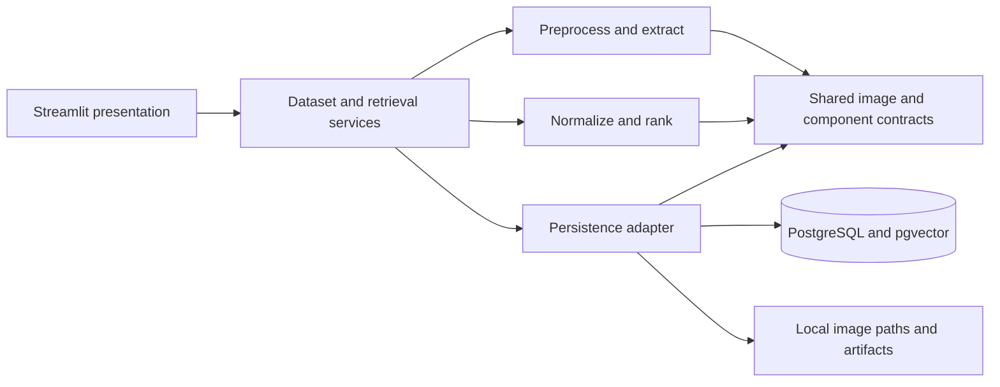
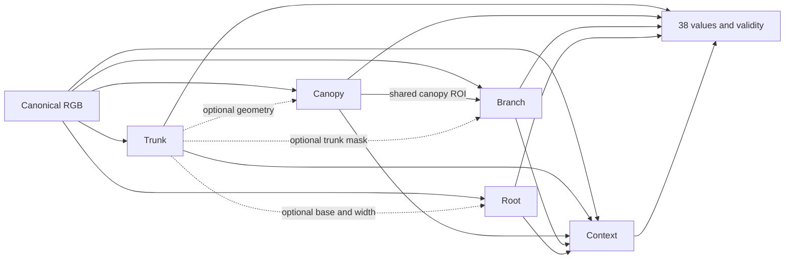
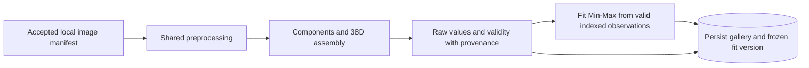
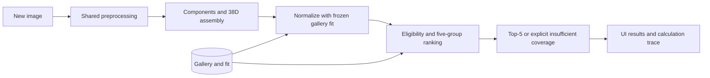

# Architecture

The system is a **modular monolith**. Streamlit calls application services in the same application. Services coordinate feature extraction and ranking and use PostgreSQL/pgvector through the persistence layer. Image files remain local. [Requirements](requirements.md) · [Executable module contracts](module_contract.md)

Arrows show allowed dependencies. Presentation consumes service outputs. Core pixel and feature modules consume shared types and libraries. DB handles records and version compatibility. Services choose execution order and fallback policy. Shared types import neither UI nor persistence. Component implementations share upstream result contracts and always receive upstream observations explicitly. [Dependency matrix](team_preparation/dependency_matrix.md) · [Shared-file ownership](team_preparation/shared_file_ownership.md)

| Layer/module | Input → output and responsibility | Current state |
| --- | --- | --- |
| `app.py` | Image upload and user options → service request, then rendered Top-5 and trace | Streamlit scaffold |
| `services/dataset.py`, `services/retrieval.py` | Corpus or query request → orchestrated ingestion or ranked results | Planned. `services/trunk_dataset.py` is separate experimental dataset tooling. |
| `preprocessing.py`, `utils/` | Path, bytes or Pillow source → canonical RGB, image metadata and reusable pixel primitives | Accepted P02 |
| `segmentation/*`, `features/*` | RGB, optional upstream observations and versioned config → masks, geometry, diagnostics and ordered group values with validity | P03 hybrid/default and trunk measurements are existing prototypes. V2 and V3 preparation are experiments. Other group algorithms are planned. |
| `models.py`, `config.py`, `component_contracts.py` | Typed observations/groups → validated contract records and a 38-position result. Caller-supplied component calls have an exception boundary. | Implemented 03/08 on top of P01/P02 types. |
| `extractor.py` | Canonical RGB → ordered component execution → assembled extraction result | Planned. The executable assembler currently accepts explicit outputs or callbacks with their dependencies supplied by the caller. |
| `normalization.py`, `similarity.py` | Valid raw vectors and a frozen fit → normalized vectors; compatible pairs and ranking profile → distances, eligibility and order | Planned |
| `database.py`, `sql/01_init.sql`, `compose.yaml` | Versioned image/vector records and local paths → stored records for an index and query gallery | Local extension and smoke test exist. Production schema and persistence are planned. |

## Component dependency graph and execution order

1. Canonicalize input once. In the default execution order, attempt trunk first. Canopy and root consume available trunk evidence and may be attempted independently after that step.
2. Branch uses the one selected canopy ROI and may consume trunk and foliage masks. Context runs after available tree-component observations and reports incomplete exclusion evidence.
3. Within each component, segmentation produces masks and geometry for the feature calculator. Assemble X0–X37 using fixed slices regardless of completion order. Keep failures local to their component unless the shared input is invalid or registration violates the contract.

## Offline database ingestion

Validate manifest and canonical images, then extract each accepted image using a single versioned profile. Fit Min–Max on valid observations from that gallery. Record raw and normalized values, validity, image reference, group slices, component provenance and fit metadata. A published index must expose a consistent gallery and fit version. Failed or incomplete records remain traceable so the index and evaluation can report coverage.

## Online image query

The query uses a compatible extractor profile and the same fit artifact. Rank only eligible pairs using the selected distance, weight and validity profile. Resolve ties by stable image ID and report incompatible versions or insufficient coverage explicitly. UI displays masks, raw/normalized values, validity and group contributions as available. Pending normalization and ranking choices are recorded in the [decision register](team_preparation/specification_decisions.md).
