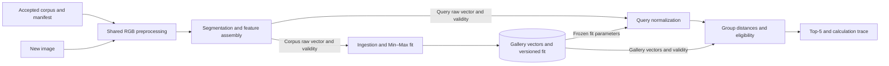

# Assignment and implementation traceability — 02/08

This matrix maps each academic requirement to future work packages and evidence. Package names describe deliverables and dependencies. Phase numbers follow the [roadmap](../roadmap.md). Rows refer to the [academic requirements](../requirements.md#academic-assignment), [canonical features](../feature_spec.md), and [ambiguity register](specification_decisions.md#ambiguity-register). The [01/08 audit](repository_audit.md) records existing implementations and open work.

## Academic requirement matrix

| ID | Source in Report 1 | Phases | Future work packages and module touchpoints | Expected deliverable and verification |
| --- | --- | --- | --- | --- |
| R01 | Assignment item 1, Part 1 §1–§2 | P02, P09, P12 | Corpus and preprocessing evidence. `preprocessing`, dataset audit/standardization scripts, `services/dataset`, manifest and data review. | Versioned manifest with ≥500 accepted unique, decodable, RGB 768×1024 images, manual one-tree/framing results and qualitative trait inventory. Validate automated checks and reviewer treatment of borderline images. |
| R02 | Assignment item 2, Part 2 §2.1–§2.5 and §4 | P03–P08, P12 | Trunk, canopy, branches, roots, context and feature-contract packages. `config`, `models`, `segmentation/*`, `features/*`, `extractor`. | Ordered per-feature specification, input/validity contract and 38 mathematical fixtures. Show representative examples of similarities/differences and group value under ablation. |
| R03 | Assignment item 3, Part 2 §2–§3 | P03–P09 | Five component packages, feature assembly, normalization and database/ingestion. `features/*`, `extractor`, `normalization`, `database`, `services/dataset`, `scripts/build_dataset.py`, SQL schema. | Repeatable extraction/ingestion, agreed schema and persisted raw/normalized values, masks or references as appropriate, groups, validity and fit provenance. Test real database round trip and deterministic re-ingestion. |
| R04 | Assignment item 4, Part 2 §3.3 | P08–P11 | Query and ranking workflow. `preprocessing`, `extractor`, `normalization`, `similarity`, `services/retrieval`, `database`, `app.py`. | New-image query using frozen gallery parameters. Verify exact, deterministic Top-5 among eligible distinct images and test insufficient coverage with explicit status. |
| R04A | Assignment item 4a | P01, P08–P11 | Architecture and integration contracts. `docs/architecture.md`, application services, core, persistence and presentation. | Updated block diagram and per-module I/O. Trace both ingest and query end to end against actual integrated code. Target flow below is the planning contract. |
| R04B | Assignment item 4b, Part 2 §3.3 | P08–P11 | Query trace and visualization. `extractor`, `similarity`, `services/retrieval`, `utils/visualization`, `app.py`. | Recompute the rank/key of a query from displayed raw/normalized values, masks, validity, overlap, group distances, weights and score. Explain any omitted score where data is invalid. |
| R04C | Assignment item 4c, Part 2 §4.4 | P12 | Evaluation and evidence. `scripts/evaluate.py`, `tests/`, `outputs/evaluation/`. | Frozen unseen queries, relevance judgments, quality metrics, failure cases and ablation. Verify commands, manifests and reproducibility. Separate segmentation diagnostics, retrieval relevance and coverage. |
| R05 | Assignment item 5 | P09–P12 | Local system demo and regression gate. `compose.yaml`, SQL, ingestion/query services, `app.py`, run instructions. | Runnable demo with corpus manifest, local DB, known evaluation version, a new-image query, five results and trace. Confirm a separate degraded query is handled explicitly. |

## Work packages and defining outputs

| Work package | Phase | Contract and dependencies | Main evidence |
| --- | --- | --- | --- |
| Repository foundations and corpus | P01–P02 | Stable image IDs and paths, standardized RGB and file integrity. Supplies every component. E01/E08. | Environment checks, dataset manifest and framing review. |
| Trunk | P03 | X0–X8 from RGB and a visible trunk mask. Export quality, expected height, base, upper point, and representative width as supporting values. Supplies canopy/root and context. E02/E07. | Formula fixtures, baseline comparison, mask reliability and calibrated choices under A01–A08/A20. |
| Canopy | P04 | X9–X16 from a common canopy ROI and foliage mask. Supply that same ROI to branch measurements. E02/E07. | Color, geometry, leafless/unknown and clipped-mask fixtures, ROI evidence under A03/A09/A10. |
| Branches | P05 | X17–X19 from exposed woody mask in the common canopy ROI. Keep X17 visibility and X18 structural support separate. E02/E07. | Shared ROI check, branch skeleton and valid zero-junction fixtures, calibration under A11. |
| Roots | P06 | X20–X25 using trusted trunk base and pixel width. Supply visible root mask/quality to context. E02/E07. | ROI, thickness, anchor connectivity and absent/unknown fixtures, calibration under A12–A14. |
| Context | P07 | X26–X37 from RGB and reliable whole-tree/root exclusion masks and lower ROI. E02/E07. | Disjoint mask tests, color swatches, variance, edge/line clipping fixtures, and A15–A19 calibration. |
| Feature assembly | P08 | Group slices 9/8/3/6/12 in X0–X37 order with validity and provenance. Same contract for both paths. E02/E08. | Order, invalid/zero, version compatibility and dependency propagation tests. |
| Storage and ingestion | P09 | Fit artifact built from valid database values. Store raw/normalized vectors, image paths, validity, and grouping. Uses P02/P08. E03/E04. | Reproducible import, round trip, failure recovery and consistent fit versions. |
| Retrieval | P10 | Query uses same extractor and fit version. Exact eligible ranking with five group distances and coverage. Uses P08/P09. E04/E05. | Oracles for distances/Top-5, monotonicity with removed features, tie order, trace and degraded-query behavior. |
| User interface and demo | P11 | Presentation consumes service results and diagnostics. E08. | One complete query walkthrough with masks, features, ranking and useful failure output. |
| Experimental evaluation and acceptance | P12 | Freeze gallery, holdout, references and configuration. Uses P08–P11. E06/E07. | Reproducible evaluation, ablations, owner-approved thresholds and evidence of R04C/R05. |

## Target workflows for R04A

| Block | Inputs | Outputs and responsibility |
| --- | --- | --- |
| Dataset and preprocessing | Image bytes/path, corpus record or query input | Standardized RGB, dimensions, image ID and quality/error diagnostics. |
| Segmentation and feature assembly | Standardized RGB and versioned extractor configuration | ROI/mask outputs and provenance, 38 raw values with validity, optional labels as metadata. |
| Ingestion and storage | Accepted corpus raw measurements, manifests and extractor version | Versioned fit, database gallery records and normalized vectors with validity. |
| Query normalization | Query measurements and matching frozen gallery fit | Query normalized vector, eligibility flags per dimension and normalization diagnostics. |
| Ranking | Compatible normalized query/gallery vectors and validity plus profile | Five group comparisons, coverage/eligibility, final scores, stable ranks and degraded status. |
| Presentation and evaluation | Ranked records and trace, plus held-out reference judgments for evaluation | Search results, an intermediate-calculation view and reproducible evaluation outputs. |

## Verification gates

1. At component acceptance, verify feature formula fixtures independently of segmentation, then validate observed masks and end-to-end feature measurements on labeled development data. Keep the semantic thresholds and helper measurements outside the vector.
2. At integration, confirm stored and queried features share one version. Exercise constant, unavailable and out-of-range normalization. Test deliberate missing values and groups, exact ranking, score explanations and insufficient eligible records.
3. At evaluation, separate development/calibration from held-out results. Use an agreed relevance rubric, score/coverage metrics, and examples of failure and successful retrieval. Reconcile the diagram and trace with the delivered implementation before demo acceptance.
